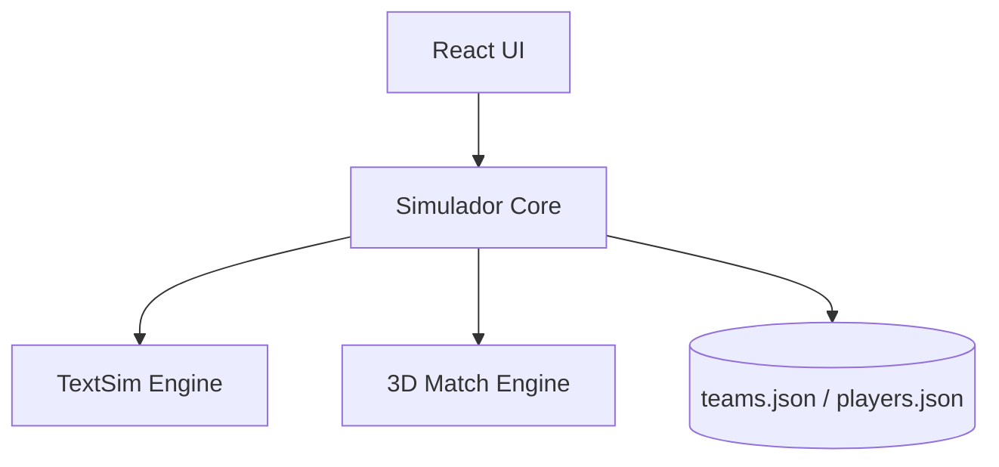

# Arquitetura Geral

## Resumo
> [!info] Propósito
> Visão macro da estrutura de software do jogo.

## Explicação Detalhada
O jogo utiliza React e TypeScript no Frontend com Vite. A simulação de partidas possui dois motores: um rápido para temporadas (TextSim) e um motor visual (3DMatch). Os dados de times e jogadores são carregados via arquivos JSON estáticos e processados localmente no client.

## Diagramas

## Relações
**Veja também:**
- [[Frontend]]
- [[Simuladores]]

## Checklist
- [ ] Implementado
- [ ] Revisado
- [ ] Testado
- [ ] Documentado
