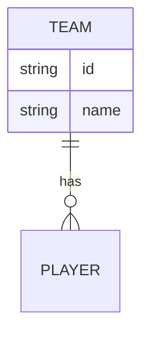

# Estrutura JSON

## Resumo
> [!info] Propósito
> Modelagem dos dados locais.

## Explicação Detalhada
Os dados são mantidos em arquivos JSON (`players.json`, `teams.json`).

**Exemplo Team:**
```json
{
  "id": 1,
  "name": "Criciúma",
  "stadium": "Heriberto Hülse"
}
```

## Diagramas


## Relações
**Veja também:**
- [[Transferências]]

## Checklist
- [ ] Implementado
- [ ] Revisado
- [ ] Testado
- [ ] Documentado
