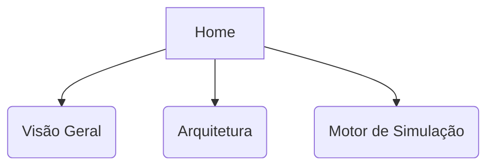

# Home

## Resumo
> [!info] Propósito
> Ponto de partida da documentação do Football Manager.

## Explicação Detalhada
Bem-vindo ao Vault do projeto Football Manager. Este repositório centraliza toda a arquitetura, motores de simulação (3D e Textual), regras de negócio e documentação técnica do jogo.

Navegue pelas pastas laterais para entender os componentes do sistema. O projeto é um simulador de gerenciamento de futebol onde o jogador assume o papel de treinador.

## Diagramas

## Relações
**Veja também:**
- [[Objetivo]]
- [[Arquitetura Geral]]

## Checklist
- [ ] Implementado
- [ ] Revisado
- [ ] Testado
- [ ] Documentado
